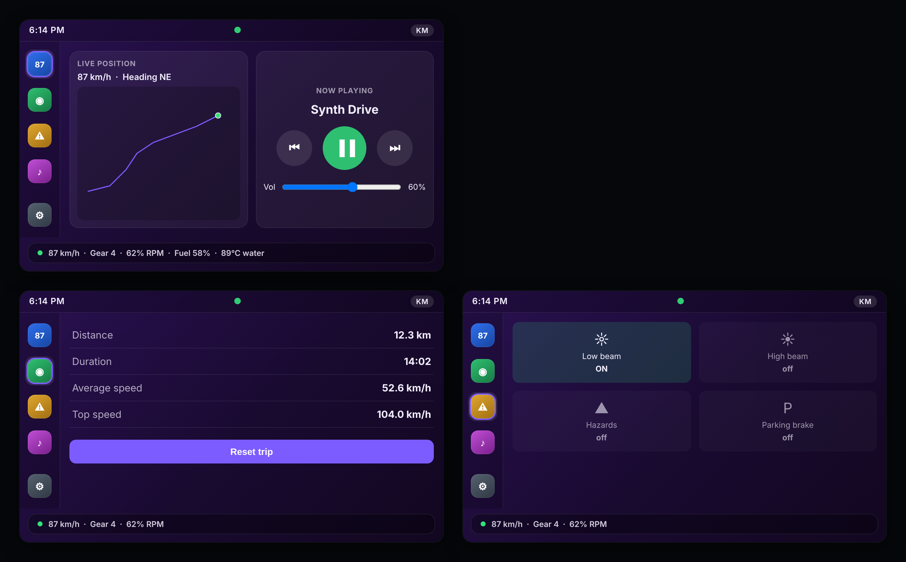

# BeamPlay — a CarPlay-inspired dash for BeamNG.drive

BeamPlay is a real BeamNG.drive **UI App** mod: a draggable, resizable
on-screen widget (the same mechanism the game uses for its built-in
speedometer, map, and fuel gauge apps) styled like a real CarPlay head
unit — a left-hand sidebar, a split-pane "Drive" home screen, and a live
stats ticker along the bottom. It's built entirely on BeamNG's public UI
modding API — no game files are patched and no third-party audio/map
assets are bundled.



*Drive (Live Position + Now Playing), Trip, and Status — rendered from the mod's actual `app.html`/`app.css` with sample data, not a mockup.*

## What it actually does

Everything below is live, backed by BeamNG's `StreamsManager`
(`electrics` / `engineInfo` streams), a custom position stream, or data
BeamPlay computes itself — nothing is a static mockup:

- **Sidebar navigation** — a persistent left-hand dock (Drive, Trip,
  Status, Radio, Settings), CarPlay-style, instead of drilling in and out
  of a home-screen grid.
- **Drive** (the default screen) — a split pane:
  - **Live Position**: a real-time breadcrumb trail of the vehicle's
    recent world position plus a heading readout, auto-scaled to fit
    on an SVG canvas. This is *not* a road map — BeamNG doesn't expose
    route/street data to mods, so there's no turn-by-turn navigation or
    ETA, just "where have you been and which way are you facing." See
    [the caveat on this below](#live-position-caveat).
  - **Now Playing**: the station name and playback controls for
    BeamPlay Radio (see below).
- **Trip computer** — session distance, elapsed time, average speed and
  top speed, all computed client-side from the vehicle's `electrics.trip`
  odometer and a wall-clock timer, with a reset button.
- **Status** — low/high beam, hazards and parking-brake indicators.
- **BeamPlay Radio** — a real, playable "radio" with four stations. There
  are no bundled MP3s (avoids bloat and licensing issues) — each station is
  a small generative synth sequence rendered live with the browser's Web
  Audio API, which is exactly the tech BeamNG's own CEF-based UI runs on.
  Play/pause, next/prev station and a volume slider all work.
- **Live stats ticker** — a bottom bar showing real telemetry (speed,
  gear, RPM, fuel, water temp) at a glance from any screen, instead of a
  fake voice-assistant prompt.
- **Settings** — metric/imperial toggle and 12h/24h clock, persisted with
  `localStorage` so they survive restarts.
- A real-world clock and an automatic day/night colour theme in the status
  bar, like an actual CarPlay unit.
- **Phone companion** — flip "Phone companion" on in Settings and
  BeamPlay starts a small local web server; open the URL it shows you in
  your phone's browser (same WiFi network as your PC, turned sideways)
  for a second screen with the same sidebar/Drive/Trip/Status/Radio
  layout, live telemetry, its own independent radio, and a working
  "Reset trip" button that reaches back into the game.
  See [Phone companion](#phone-companion) below.

### Not actual Apple CarPlay

This mirrors CarPlay's *look*, not Apple's protocol. Real CarPlay requires
either MFi hardware certification (to appear as a receiver/head unit) or an
Apple-granted CarPlay entitlement for a narrow set of app categories
(audio, navigation, messaging, EV charging, etc.) to appear as an app
inside someone else's CarPlay — neither is realistic for a game mod, and
both would be a separate iOS project unrelated to this one. The phone
companion gets you the "second screen in your hand" experience over your
own WiFi instead, with no Apple gatekeeping involved. The reference
screenshot's turn-by-turn Maps panel and Siri weather assistant are also
not reproduced as-is: see [Live Position caveat](#live-position-caveat)
and the ticker bullet above for what replaced them, and why.

### Live Position caveat

The Live Position trail depends on a vehicle object's `getPosition()` and
`getDirectionVector()` methods (see `lua/ge/extensions/beamPlayPosition.lua`).
Unlike the `electrics`/`engineInfo` fields (cross-checked against two
independently published BeamNG UI mods), these exact method names are
**not independently verified against a real BeamNG install** from this
development environment — every call is wrapped in `pcall`, so if BeamNG
renames or removes them, the Drive screen just shows "Position unavailable"
instead of breaking. If that happens, please open an issue (or it'll likely
get caught by the [monthly compatibility check](#compatibility)).

## Compatibility

Last checked against **BeamNG.drive 0.39.x** (October 2026). The
`electrics` field names and `engineInfo` array indices this mod reads
(documented in [Notes on the underlying BeamNG UI
API](#notes-on-the-underlying-beamng-ui-api) below) are internal,
undocumented parts of BeamNG's API that can change between versions
without notice. This line is updated roughly monthly as new BeamNG
versions ship; if something here breaks after a game update before that
happens, please open an issue.

<!-- beamng-version-check: last verified 2026-10-31 against BeamNG.drive 0.39.x -->

## Install (2 minutes)

BeamNG UI apps live in the game's `ui/modules/apps/` folder, and this
mod's two server-side pieces live in `lua/ge/extensions/`. The quickest
way to try BeamPlay is to drop both folders straight into your BeamNG
install:

1. Locate your BeamNG install folder, e.g. on Windows:
   `C:\Program Files (x86)\Steam\steamapps\common\BeamNG.drive\`
   (or wherever Steam/the standalone installer put it).
2. Copy this repo's `ui/modules/apps/BeamPlay` folder into
   `<install>\ui\modules\apps\`, so you end up with
   `...\BeamNG.drive\ui\modules\apps\BeamPlay\app.json` etc.
3. Copy both of this repo's Lua extensions into
   `<install>\lua\ge\extensions\`:
   - `beamPlayPosition.lua` — powers the Drive screen's Live Position
     trail. Without it, Drive just shows "Position unavailable"; nothing
     else is affected.
   - `beamPlayServer.lua` — powers the phone companion feature. Without
     it, the "Phone companion" toggle in Settings won't do anything;
     nothing else is affected.
4. Launch BeamNG, load into a vehicle, open the **Apps** menu (top-right
   gear/grid icon in the driving UI) and drag **BeamPlay** onto your
   screen.

### Installing as a `mods/` package instead

If you'd rather install it the same way downloaded mods work (via
`Documents/BeamNG.drive/<version>/mods/`), zip up the `ui/` and `lua/`
folders here (so the zip's root contains `ui/modules/apps/BeamPlay/...`
and both files under `lua/ge/extensions/`, matching the game's own folder
layout) into e.g. `BeamPlay.zip`, then drop that zip into
`Documents/BeamNG.drive/<version>/mods/`. BeamNG mounts mod zips without
unpacking them, and the app will show up in the in-game Apps menu exactly
the same way.

```
# from the repo root:
zip -r BeamPlay.zip ui lua
# -> BeamPlay.zip, ready to drop in the mods/ folder
```

## Phone companion

1. In-game, open BeamPlay's **Settings** screen and tap "Phone companion"
   to turn it on. BeamPlay loads `beamPlayServer.lua` and starts a small
   HTTP server (default port `23515`, LAN-only — it's not exposed to the
   internet).
2. Settings then shows a URL. BeamNG's Lua sandbox doesn't reliably expose
   a way to auto-detect your PC's own network address (this has failed in
   practice, not just in theory), so **don't count on the auto-detected
   address working** — Settings also shows a text field for your PC's LAN
   IP. Find it yourself (`ipconfig` on Windows, look for "IPv4 Address";
   `ip addr` or `ifconfig` on Linux/macOS) and type it in; the shown URL
   updates immediately and a manually-entered IP always takes priority
   over auto-detection.
3. Open that exact URL in your phone's browser (turn the phone sideways
   for the full layout), as long as the phone is on the **same WiFi
   network** as your PC. Windows Firewall may prompt to allow the
   connection the first time — allow it.
4. The phone page polls `/data.json` once a second for live telemetry —
   including the Live Position trail and the stats ticker — and plays its
   own independent synth radio locally (not audio streamed from the PC —
   no round trip needed for that). The Trip screen's **Reset trip**
   button is a real round trip: it hits `/command/reset-trip` on the
   server, which the game polls and acts on within half a second.

Turning "Phone companion" back off in Settings stops the server. It's also
stopped automatically if you remove the BeamPlay widget from your HUD.

## Verifying it works

This repo can't launch BeamNG itself, so verification is split two ways:

1. **Automated** — every piece of logic that doesn't need the game (unit
   conversion, gear-text formatting, RPM-bar math, trip-time formatting,
   status-flag parsing, radio station cycling, note-frequency math, the
   position-trail projection math, the live-stats ticker, the
   phone-companion payload shape) is a plain, dependency-free JS function,
   unit tested with Node's built-in test runner:

   ```
   npm test
   ```

   42 tests cover the math/formatting BeamPlay's UI displays, plus checks
   that the companion page (embedded as a string in the Lua server) is
   syntactically valid JS and only reads fields the payload builder
   actually sends — so the two can't silently drift apart.

2. **Manual, in-game** (do this after installing, to confirm the Angular/
   BeamNG-glue and Lua halves that can't run outside the game):
   - [ ] App appears in the in-game Apps picker and can be dragged onto the HUD.
   - [ ] Sidebar icons switch screens; the active one is highlighted.
   - [ ] With the engine running, Drive's speed/heading readout and the
         bottom ticker track the vehicle in real time.
   - [ ] Drive's Live Position trail draws a line as you drive, with a dot
         at your current position; if it says "Position unavailable"
         instead, see [the caveat](#live-position-caveat).
   - [ ] Trip screen's distance/timer increase while driving; **Reset
         trip** zeroes them.
   - [ ] Status screen's low-beam/hazard/parking-brake tiles light up when
         you toggle those in-game.
   - [ ] Radio (from the sidebar, or the Drive screen's Now Playing card):
         tapping ▶ produces audible synth audio; ⏮/⏭ change station and
         the audio changes; the volume slider changes loudness.
   - [ ] Settings: switching Metric/Imperial changes the units shown
         elsewhere; the choice survives closing and reopening the app.
   - [ ] Settings: enabling "Phone companion" shows a URL; that URL loads
         a matching CarPlay-styled page on a phone on the same WiFi.
   - [ ] On the phone page: Drive/Trip/Status tiles update live, including
         its own Live Position trail; Radio plays audio on the phone
         itself; **Reset trip** on the phone zeroes the in-game trip
         screen too.

## Why the file layout looks like this

```
.
├── ui/modules/apps/BeamPlay/    ← the UI app (mirrors BeamNG's own folder layout)
│   ├── app.json                 ← manifest: name, default size/position, directive
│   ├── app.html                 ← AngularJS template (sidebar + 5 screens)
│   ├── app.css                  ← styling
│   ├── app.js                   ← pure logic (Node-testable) + the Angular directive
│   └── app.png                  ← app-picker icon
├── lua/ge/extensions/
│   ├── beamPlayPosition.lua     ← registers the live position/heading stream
│   └── beamPlayServer.lua       ← local HTTP server for the phone companion
├── generate_icon.py             ← regenerates app.png (Pillow); not needed at runtime
├── tests/
│   ├── logic.test.js            ← Node test-runner suite for the pure logic in app.js
│   └── companion-page.test.js   ← validates the Lua-embedded companion page's JS
├── package.json                 ← `npm test` entry point
└── README.md
```

`ui/modules/apps/BeamPlay/` and `lua/ge/extensions/` are exactly the paths
BeamNG expects inside its own install folder or inside a mod zip — that's
why they're nested instead of flattened.

## Notes on the underlying BeamNG UI API

BeamPlay follows the same pattern used by other published BeamNG UI-app
mods (cross-checked against two independently maintained ones):

- Apps register as AngularJS directives on `angular.module('beamng.apps')`,
  with `templateUrl`/`domElement` wired up in `app.json`.
- Live telemetry comes from `StreamsManager.add([...])` plus a
  `$scope.$on('streamsUpdate', function (event, streams) { ... })`
  listener, cleaned up on `$scope.$on('$destroy', ...)`.
- Speed reads `electrics.wheelspeed` (falling back to `electrics.airspeed`);
  gear and RPM read fixed indices of the `engineInfo` array (`[16]` gear,
  `[4]` current RPM, `[1]` redline, `[0]` idle RPM) — the same indices used
  by other published gauge mods.
- Optional fields (`fuel`, `watertemp`, `oiltemp`, `lowbeam`, `highbeam`,
  `signal_L`/`signal_R`, `hazard_enabled`, `parkingbrake`) are read
  defensively: if a vehicle/BeamNG version doesn't expose one, BeamPlay
  shows a neutral "n/a"/`--` instead of guessing.
- The Live Position stream (`lua/ge/extensions/beamPlayPosition.lua`)
  registers a custom stream via `streams.registerStream('beamPlayPosition', getState)`
  — the same mechanism BeamNG's own extensions use to expose data to UI
  apps — reading the focused vehicle's `getPosition()`/`getDirectionVector()`
  each frame. See [the caveat above](#live-position-caveat) on why this
  one is less certain than the electrics/engineInfo fields.
- The phone companion's server (`lua/ge/extensions/beamPlayServer.lua`) is
  a GE extension: `extensions.load("beamPlayServer")` from the UI app,
  then `M.onUpdate` (BeamNG's per-frame extension hook) drives a
  non-blocking LuaSocket TCP accept/receive loop, matching the approach
  another published BeamNG mod uses for its own local web endpoint. The UI
  app pushes a JSON snapshot into the server via
  `bngApi.engineLua('extensions.beamPlayServer.setData(...)')`; the server
  itself does no telemetry reading of its own, it only stores and re-serves
  that string, plus a tiny one-item command queue for the phone's
  "Reset trip" button.
